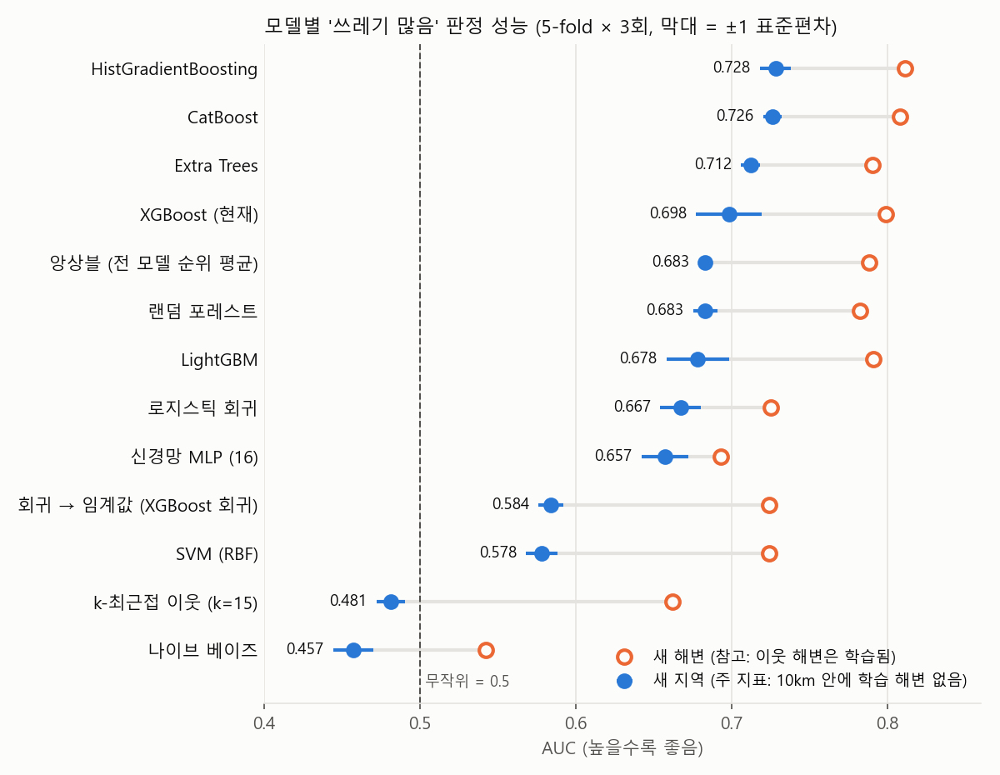
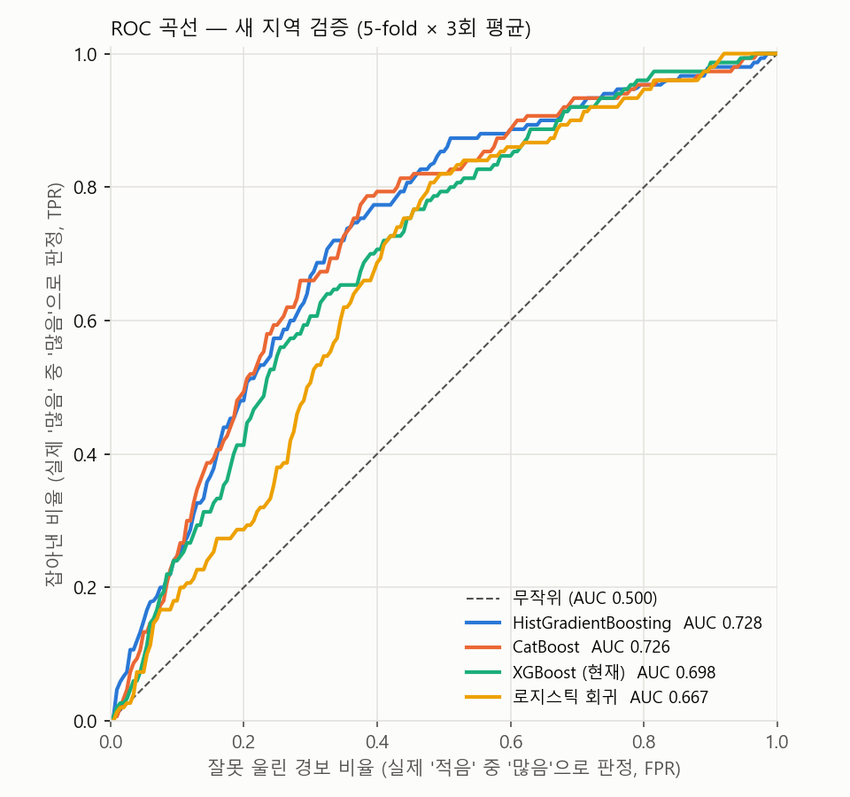
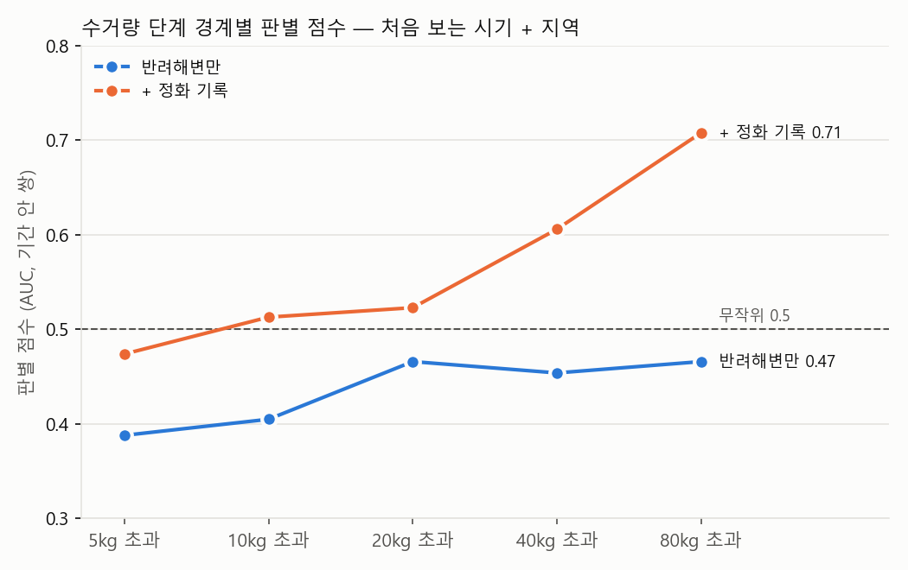

# 해변 쓰레기 '많음' 예측 — 모델 비교 리포트

2026-11-19 · 데이터: 모두의 반려해변 해변×수거일 358건 (해변 94곳, 2022-05 ~ 2026-10)

> ## 2026-11-20 갱신 — 평가 기준이 바뀌었어요
> - **주 지표를 '처음 보는 시기 + 처음 보는 지역'으로 바꿨어요.** 반년마다 기준일을 두고 그 이전 자료로만 학습한 뒤,
>   이후 6개월 동안 10km 밖 새 지역 해변을 맞혀요 (`python analysis.py a23`).
> - **아래 1~5절의 0.70대 점수는 시기를 섞은 값이에요.** 같은 시기 다른 지역의 기록이 학습에 들어가 있어서,
>   '같은 시기 추정'용 참고값이에요. 미래 예측 성능이 아니에요.
>
> | 처음 보는 시기 + 지역 | 판별 점수 (AUC) |
> |---|---|
> | 반려해변만 | **0.558** — 거의 우연 수준 |
> | + 오션 컨저번시 정화 기록 (2016–2026, 2024 파일 빠짐) | **0.697** (차이 +0.139, 95% 구간 −0.044 ~ +0.341) |
>
> - 정화 기록을 더하면 평균은 오르지만, 시험 '많음'이 48건뿐이라 아직 확정할 수 없어요.
>   2024 파일이 빠지면서 2025년 상반기 점수가 0.73 → 0.50으로 내려갔어요 → 2024 파일을 다시 받아 재실행할 예정이에요.
> - 정화 기록 지점의 좌표는 기록을 올린 위치인 경우가 많아, 위성 판독으로 해안이 아닌 지점 259곳을 걸러냈어요.
> - 다음 실험(모델 단 개선) 계획은 실행 전에 `CLAUDE.md` '다음 실험 계획'에 고정해 두었어요.
> - 과제를 '77킬로그램 초과' 대신 **수거량 단계(6단계)**로 바꾼 시험 결과는 6절에 있어요.
> - 라벨을 등록 단체 수거만으로 다시 만드는 표준화 정제는 효과가 없었어요(7절). 주 지표는 0.558 / 0.697 그대로예요.

## 한눈에

- **가장 좋은 모델은 HistGradientBoosting과 CatBoost**예요. 새 지역 AUC 0.728 / 0.726으로, 현재 XGBoost(0.698)보다 약 0.03 높아요.
- 다만 이 0.03 차이는 검증 불확실성 경계에 있어요. 여러 모델 중 고르는 절차 자체를 중첩 검증하면 0.695예요. 결론적으로 **부스팅 트리 계열이면 0.70~0.73 수준**이고, SVM·kNN·나이브 베이즈·회귀 후 판정은 뚜렷하게 나빠요.
- 추천은 **HistGradientBoosting**이에요. AUC와 균형정확도가 모두 1위이고, scikit-learn에 들어 있어서 의존성이 늘지 않아요.
- **AUC 0.8 이상**은 하루 단위 판정으로는 아직 어렵고, 연 단위 판정에서 나와요. KOEM 국가 모니터링 기준 정점별 다음 해 판정은 0.88~0.96이에요.

## 과제 정의

| 항목 | 내용 |
|---|---|
| 판정 | 해변×수거일의 **세션당 쓰레기 무게**가 '많음(주의 요함)'인가 (이진 분류) |
| '많음' 기준 | EU 해안 쓰레기 기준선 287개/100m(EEA 지표)를 넘는 비율(KOEM 조사의 18.9%)만큼, 기준기간(2022–24) 분포의 상위 구간 → 세션당 77kg 초과. 참고로 EU 양호 기준치는 20개/100m ([Van Loon et al. 2020, JRC](https://publications.jrc.ec.europa.eu/repository/handle/JRC121707)) |
| 양성 비율 | 14.0% — 전부 '적음'으로 찍어도 정확도 86%라서 **AUC와 균형정확도로 비교** |
| 검증 (주 지표) | **새 지역**: 10km 안 해변을 한 묶음으로 묶어 묶음 단위 5-fold × 3회. 테스트 지역의 기록과 이웃 해변은 학습에 들어가지 않음 |
| 피처 | 계절·연도, 관광(이용객·시즌), 조석 위상, 위성 판독 지형 12종 — 해변 자신의 과거 기록과 좌표는 쓰지 않아 **처음 보는 해변에도 적용 가능** |

## 1. 모델 비교



| 순위 | 모델 | 계열 | **AUC 새 지역** | 균형정확도 새 지역 | AUC 새 해변 (참고) |
|---|---|---|---|---|---|
| 1 | **HistGradientBoosting** | 부스팅 트리 | **0.728** ± 0.010 | **0.640** | 0.811 |
| 2 | CatBoost | 부스팅 트리 | 0.726 ± 0.006 | 0.616 | 0.808 |
| 3 | Extra Trees | 배깅 트리 | 0.712 ± 0.006 | 0.577 | 0.790 |
| 4 | XGBoost (현재 `train.py`) | 부스팅 트리 | 0.698 ± 0.021 | 0.607 | 0.799 |
| 5 | 앙상블 (전 모델 순위 평균) | 앙상블 | 0.683 ± 0.004 | — | 0.788 |
| 5 | 랜덤 포레스트 | 배깅 트리 | 0.683 ± 0.008 | 0.558 | 0.782 |
| 7 | LightGBM | 부스팅 트리 | 0.678 ± 0.020 | 0.606 | 0.791 |
| 8 | 로지스틱 회귀 | 선형 | 0.667 ± 0.013 | 0.636 | 0.725 |
| 9 | 신경망 MLP | 신경망 | 0.657 ± 0.015 | 0.528 | 0.693 |
| 10 | 회귀 → 임계값 | 회귀 후 판정 | 0.584 ± 0.008 | 0.500 | 0.724 |
| 11 | SVM (RBF) | 커널 | 0.578 ± 0.010 | 0.499 | 0.724 |
| 12 | k-최근접 이웃 | 거리 | 0.481 ± 0.009 | 0.499 | 0.662 |
| 13 | 나이브 베이즈 | 확률 | 0.457 ± 0.013 | 0.491 | 0.542 |

- 모든 모델은 같은 피처·라벨·검증 분할을 쓰고, 설정은 미리 고정했어요(튜닝 없음).
- 새 해변(참고)은 새 지역보다 **0.08~0.18 높게** 나와요. 이웃 해변 정보가 새기 때문이라 성능 보고에는 쓰지 않아요.
- 회귀 → 임계값의 균형정확도가 0.500인 이유: 회귀 예측이 평균 쪽으로 수축해서, 상위 14% 기준선을 넘는 예측이 거의 나오지 않아요.

### ROC 곡선 (새 지역)



| 잘못 울린 경보 비율 (FPR) 허용 | HistGradientBoosting | CatBoost | XGBoost (현재) | 로지스틱 회귀 |
|---|---|---|---|---|
| 10% | 25% | 25% | 24% | 18% |
| 20% | **48%** | **49%** | 41% | 29% |
| 30% | **67%** | 66% | 61% | 51% |

- 곡선이 왼쪽 위에 붙을수록 좋아요. 표의 값은 그 오경보 수준에서 실제 '많음'인 날을 잡아낸 비율(TPR)이에요.
- HGB와 CatBoost는 거의 겹쳐요. XGBoost보다 **오경보 15~60% 구간 전반에서 약 3~7%p 더** 잡고, 오경보 65% 이상에서는 모델들이 비슷해요.
- 곡선은 3회 반복의 ROC를 같은 FPR 격자에 보간해 평균한 것이고, 곡선 아래 넓이는 위 표의 AUC와 같아요.

## 2. 이 정확도의 의미 (HistGradientBoosting, 새 지역)

- **AUC 0.73**: 무작위로 고른 '많음'인 날과 '적음'인 날을 비교했을 때, 모델이 '많음'인 날을 더 위험하게 점수 매길 확률이 73%예요(무작위 50%).
- **균형정확도 0.64**: '많음'과 '적음' 각각의 정답률 평균이에요.
- 쓰임새: 수거·점검 **우선순위 정하기**에는 쓸 만하고, 개별 날짜를 단정하는 경보로는 부족해요(현재 XGBoost 기준 정밀도 0.25 — '많음' 경보 4번 중 1번만 실제로 '많음').

## 3. 무엇이 영향을 줬나


- **바위 해안**(위성 판독)이 가장 커요. 바위 틈에 쓰레기가 갇혀요. KOEM에서도 같은 방향이에요.
- **계절**: 겨울~봄에 많아요. 북서 계절풍이 쓰레기를 밀어 올리고 청소가 적은 시기예요.
- **이용객 수·도시화·해수욕 시즌**은 모두 '적음' 방향이에요. 지자체 정기 청소의 흔적으로 보이는데, 청소 기록 자체는 구할 수 없어서 이 간접 지표들이 대신하고 있어요.
- 해변 길이·직전 수거 후 경과일·호안은 새 지역에서 노이즈였어요. 다만 빼는 결정은 중첩 검증에서 이득이 없어서 그대로 두었어요(아래 한계 참고).
- '많음'인 날은 플라스틱 무게의 99%가 **어망·로프·부표**예요. 사실상 어업 폐기물 대량 유입 경보예요.

## 4. 예측 단위에 따른 상한

| 데이터 · 단위 | 판정 | AUC |
|---|---|---|
| 반려해변 · 해변×수거일 (새 지역) | 많음 | 0.728 (HGB) |
| 반려해변 · 해변×연도, 기록 3건 이상 (새 해변) | 중앙값 기준 많음/적음 | 0.846 (표본 45) |
| KOEM · 정점×조사 | EU 기준선(287개/100m) 초과 | 0.806 |
| KOEM · 정점×연도, 과거 연도로만 학습 → 다음 해 | EU 기준선 초과 / EU 기준치(20개/100m) 초과 | **0.880 / 0.955** |

하루 단위 기록에는 누가 얼마나 주웠는지, 큰 그물이 걸렸는지 같은 우연이 섞여 있어서, 0.8을 넘으려면 **연 단위 판정**이나 **해변별 반복 기록**이 필요해요.

## 5. 한계와 주의

- **선택 편향**: 같은 검증 데이터를 보고 고르면 성능이 부풀려져요. 실제로 확인된 두 사례가 있어요. 피처 3개를 빼면 0.698 → 0.772처럼 보였지만 중첩 검증에서는 0.690이었어요. 모델 선택도 중첩 검증하면 0.695예요. 1위 모델의 +0.03도 **새 데이터(예: 2027년 기록)로 다시 확인**해야 해요.
- **지역 편중**: 가장 큰 10km 묶음(인천·영종)이 행의 43%를 차지해요.
- **지형 라벨**: 위성 영상(Esri)을 Claude가 판독한 것이고, 신뢰도 1(낮음)인 27곳은 사람 검수 전이에요.
- **저장소에 넣지 않은 데이터**: 반려해변 원자료(CC BY-NC), ERA5·ASOS 원본(대용량), KOEM 정리본(재배포 범위 불명), 이들에서 파생된 행 단위 피처. 출처는 `dataset/README.md`에 있어요.

## 6. 시험 — 과제를 '수거량 단계'로 바꿨을 때 (2026-11-20)

성능을 올리려는 시험이 아니에요. 비율만 맞춰 옮겨 온 77킬로그램 하나 대신, 더 설명하기 쉬운 과제 정의를 확인하려는 시험이에요.

**과제**: 정화 활동 1회당 수거량을 두 배 간격으로 나눈 6단계예요. 한 단계 올라가면 두 배예요. 경계는 결과를 보기 전에 고정했어요.

| 단계 | 0 | 1 | 2 | 3 | 4 | 5 |
|---|---|---|---|---|---|---|
| 1회당 수거량 (킬로그램) | 5 이하 | 5–10 | 10–20 | 20–40 | 40–80 | 80 초과 |
| 반려해변 기록 수 | 108 | 26 | 55 | 60 | 62 | 47 |
| 정화 기록 수 | 781 | 194 | 132 | 121 | 112 | 342 |

**방법**
- 경계마다 '이 양을 넘는가'를 맞히는 이진 모델 5개를 만들었어요. 피처와 설정은 지금 XGBoost와 같아요.
- 넘을 확률이 뒤 경계에서 앞 경계보다 커지지 않게 맞췄어요.
- 점수는 기대 단계(넘을 확률의 합)예요.
- 검증은 주 지표와 같아요(처음 보는 시기 + 지역, 반년마다 기준일).
- 지표는 **순서 일치도**예요. 같은 기간 안에서 단계가 다른 두 기록 중 어느 쪽이 더 많은지를 맞힌 비율이에요(무작위 0.5). 이진 과제라면 기간 안 쌍 AUC와 같아요.

| 검증 | 학습 자료 | 순서 일치도 | 95% 구간 |
|---|---|---|---|
| **처음 보는 시기 + 지역 (주)** | 반려해변만 | 0.432 | 0.374 ~ 0.535 |
| | + 정화 기록 | **0.552** | 0.484 ~ 0.664 |
| | 차이 | **+0.120** | +0.021 ~ +0.236 |
| 새 지역, 시기 섞임 (참고) | 반려해변만 | 0.598 | 0.557 ~ 0.687 |
| | + 정화 기록 | 0.517 | 0.472 ~ 0.644 |
| | 차이 | −0.081 | −0.113 ~ −0.005 |



| 경계별 판별 점수 (주 검증) | 5 초과 | 10 초과 | 20 초과 | 40 초과 | 80 초과 | 77 초과 (참고: 지금 이진 모델) |
|---|---|---|---|---|---|---|
| 반려해변만 | 0.388 | 0.405 | 0.466 | 0.454 | 0.466 | 0.439 (0.558) |
| + 정화 기록 | 0.474 | 0.513 | 0.523 | 0.606 | **0.708** | **0.711** (0.697) |

**무엇을 알았나**
- **큰 수거량만 맞힐 수 있어요.**
  - 정화 기록을 더하면 80킬로그램 초과 판별은 0.71로, 지금의 77킬로그램 이진 모델(0.697)과 같은 수준이에요.
  - 5~20킬로그램 경계는 무작위 수준이에요.
- **작은 수거량은 쓰레기 양보다 활동 규모를 반영하는 것으로 보여요.**
  - 2025년 하반기부터 반려해변 참여 해변이 반기당 7~9곳에서 74곳으로 늘었어요. 같은 시기에 1회 수거량 중앙값은 25~42킬로그램에서 9~13킬로그램으로, 5킬로그램 이하 비율은 0~30%에서 40%로 바뀌었어요.
  - 하루 수거가 1회뿐인 날은 5킬로그램 이하가 47%, 9회 이상인 날은 17%예요. 혼자 짧게 한 수거일수록 작은 값이 나오는데, 이건 환경 피처로 맞힐 수 없어요.
- **단계 자체를 맞히는 데는 아직 못 써요.**
  - 정확히 맞힌 비율은 13~15%, 한 단계 이내로 맞힌 비율은 32~41%예요.
  - 전부 가장 흔한 단계로 찍어도 29% / 37%예요. 이 기준은 시험 정답 분포를 보고 고른 것이라 유리한 기준이에요.
  - 정화 기록은 5킬로그램 이하가 46%라 반려해변과 확률 척도가 어긋나요.
- **정화 기록의 효과는 시기에 따라 반대로 나와요.**
  - 미래 예측에서는 도움이 됐어요(+0.12).
  - 같은 시기 반려해변 기록이 학습에 있을 때는 오히려 해가 됐어요(−0.08). 작은 기록이 많은 분포가 섞여서 그런 것으로 보여요.

**연구 정의에 주는 뜻**
- 단계 과제는 "어디까지 예측할 수 있나"를 드러내요. 40킬로그램 이상의 큰 유입(사실상 어구)은 일부 예측할 수 있지만, 작은 수거량은 참여 규모의 잡음이에요.
- 그래서 6단계 전체를 맞히는 것보다, 경계별 판별 점수를 곡선으로 보고하는 방식이 더 정직해요. 인원 기록이 생기기 전까지 아래쪽 단계는 묶어서 다루는 쪽이 말이 돼요.
  - 다만 '아래쪽을 묶은 3단계'는 이 결과를 보고 나온 생각이에요. 새 자료로 확인해야 해요.
- 이 시험은 PoC예요. 시험용 '많음' 기록을 여러 번 써 온 같은 검증이라, 채택 판단에는 쓰지 않아요.

## 7. 시험 — 라벨을 등록 단체 수거만으로 (2026-11-20)

**가설**: 해변 등록 없이 위치로만 붙인 개인 수거(1회 중앙값 0.9킬로그램)가 '1회당 수거량'을 희석한다.

**방법**
- 같은 날 같은 해변의 무게와 횟수를 등록 단체 수거만으로 다시 계산했어요.
- '많음' 경계는 같은 절차로 다시 정했어요. 80.4킬로그램이고, 라벨이 있는 날은 336행이에요.
- 학습 라벨과 시험 라벨을 따로 바꿔 봤어요. 검증은 주 지표와 같아요.

| 시험 라벨 | 학습 라벨 | 반려해변만 | + 정화 기록 |
|---|---|---|---|
| **지금 라벨 (공정 비교)** | 지금 라벨 | 0.558 | 0.697 |
| | 등록 수거만 | 0.538 (−0.020, 구간 −0.086 ~ +0.025) | 0.690 (−0.007, 구간 −0.018 ~ +0.012) |
| 등록 수거만 (문제가 바뀜) | 지금 라벨 | 0.554 | 0.738 |
| | 등록 수거만 | 0.541 | 0.737 |

- **공정 비교에서 효과가 없어요.** 차이가 모두 0 근처이고, 구간도 0을 포함해요.
- **시험 라벨을 바꾸면 0.738로 올라요.** 하지만 어느 라벨로 학습하든 같은 값이에요. 시험 기록 구성이 바뀐 효과이지, 모델이 나아진 게 아니에요.
- **단계 과제도 그대로예요.** 등록 수거만으로 해도 순서 일치도가 0.435 / 0.554이고, 5~20킬로그램 경계는 여전히 무작위 수준(0.49~0.52)이에요.

**효과가 없었던 이유**
- 위치로만 붙인 개인 수거 641건 가운데 등록 해변 1킬로미터 안에 있어서 라벨에 들어간 건 151건(7%)뿐이에요. 앞에서 말한 '최근 40%'는 전체 수거 기준이었어요.
- 작은 수거량이 늘어난 건 **등록 단체 안에서** 생긴 변화예요.

  | 등록 단체 수거 1회 | 2025년 상반기까지 | 2025년 하반기 이후 |
  |---|---|---|
  | 수거량 중앙값 | 12.9킬로그램 | 5.5킬로그램 |
  | 5킬로그램 이하 비율 | 35% | 48% |

- 참여 단체 구성이 바뀐 것으로 보여요. 인원이나 수거 시간 기록 없이는 표준화로 고칠 수 없어요.

## 재현

```bash
python data_load.py          # 원천 데이터 → outputs/features.csv (원천 데이터 필요)
python train.py              # 현재 XGBoost 분류기, 새 지역 검증
python analysis.py a20       # 전체 모델 비교 → outputs/analysis/A20_all_models.csv, A20_roc_new_region.csv
python analysis.py a23 a24 a24r a25   # 주 지표(처음 보는 시기 + 지역), 수거량 단계 PoC, 등록 수거만 라벨
python -c "import analysis; analysis.figures()"   # 이 리포트의 그림
```

평가 원칙(새 지역 검증, 노력량 표준화, 좌표 금지, 중첩 검증)은 `CLAUDE.md`에 정리돼 있어요.
