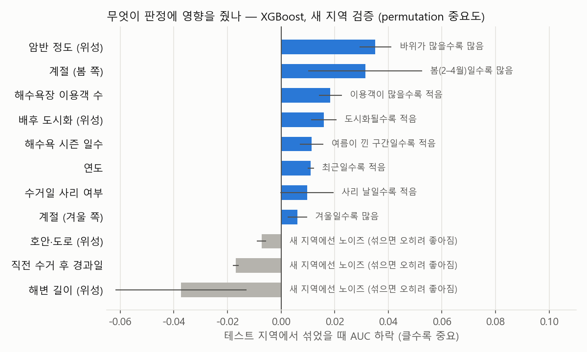

# 해변 쓰레기 '많음' 예측 — 모델 비교 리포트

2026-11-19 · 데이터: 모두의 반려해변 해변×수거일 358건 (해변 94곳, 2022-05 ~ 2026-10)

## 한눈에

- **가장 좋은 모델은 HistGradientBoosting과 CatBoost**예요. 새 지역 AUC 0.728 / 0.726으로, 현재 XGBoost(0.698)보다 약 0.03 높아요.
- 다만 이 0.03 차이는 검증 불확실성 경계에 있어요. 여러 모델 중 고르는 절차 자체를 중첩 검증하면 0.695예요. 결론적으로 **부스팅 트리 계열이면 0.70~0.73 수준**이고, SVM·kNN·나이브 베이즈·회귀 후 판정은 뚜렷하게 나빠요.
- 추천은 **HistGradientBoosting**이에요. AUC와 균형정확도가 모두 1위이고, scikit-learn에 들어 있어서 의존성이 늘지 않아요.
- **AUC 0.8 이상**은 하루 단위 판정으로는 아직 어렵고, 연 단위 판정에서 나와요. KOEM 국가 모니터링 기준 정점별 다음 해 판정은 0.88~0.96이에요.

## 과제 정의

| 항목 | 내용 |
|---|---|
| 판정 | 해변×수거일의 **세션당 쓰레기 무게**가 '많음(주의 요함)'인가 (이진 분류) |
| '많음' 기준 | EU 해안 쓰레기 기준선 287개/100m(EEA 지표)를 넘는 비율(KOEM 조사의 18.9%)만큼, 기준기간(2022–24) 분포의 상위 구간 → 세션당 77kg 초과. 참고로 EU 양호 기준치는 20개/100m ([Van Loon et al. 2020, JRC](https://publications.jrc.ec.europa.eu/repository/handle/JRC121707)) |
| 양성 비율 | 14.0% — 전부 '적음'으로 찍어도 정확도 86%라서 **AUC와 균형정확도로 비교** |
| 검증 (주 지표) | **새 지역**: 10km 안 해변을 한 묶음으로 묶어 묶음 단위 5-fold × 3회. 테스트 지역의 기록과 이웃 해변은 학습에 들어가지 않음 |
| 피처 | 계절·연도, 관광(이용객·시즌), 조석 위상, 위성 판독 지형 12종 — 해변 자신의 과거 기록과 좌표는 쓰지 않아 **처음 보는 해변에도 적용 가능** |

## 1. 모델 비교


| 순위 | 모델 | 계열 | **AUC 새 지역** | 균형정확도 새 지역 | AUC 새 해변 (참고) |
|---|---|---|---|---|---|
| 1 | **HistGradientBoosting** | 부스팅 트리 | **0.728** ± 0.010 | **0.640** | 0.811 |
| 2 | CatBoost | 부스팅 트리 | 0.726 ± 0.006 | 0.616 | 0.808 |
| 3 | Extra Trees | 배깅 트리 | 0.712 ± 0.006 | 0.577 | 0.790 |
| 4 | XGBoost (현재 `train.py`) | 부스팅 트리 | 0.698 ± 0.021 | 0.607 | 0.799 |
| 5 | 앙상블 (전 모델 순위 평균) | 앙상블 | 0.683 ± 0.004 | — | 0.788 |
| 5 | 랜덤 포레스트 | 배깅 트리 | 0.683 ± 0.008 | 0.558 | 0.782 |
| 7 | LightGBM | 부스팅 트리 | 0.678 ± 0.020 | 0.606 | 0.791 |
| 8 | 로지스틱 회귀 | 선형 | 0.667 ± 0.013 | 0.636 | 0.725 |
| 9 | 신경망 MLP | 신경망 | 0.657 ± 0.015 | 0.528 | 0.693 |
| 10 | 회귀 → 임계값 | 회귀 후 판정 | 0.584 ± 0.008 | 0.500 | 0.724 |
| 11 | SVM (RBF) | 커널 | 0.578 ± 0.010 | 0.499 | 0.724 |
| 12 | k-최근접 이웃 | 거리 | 0.481 ± 0.009 | 0.499 | 0.662 |
| 13 | 나이브 베이즈 | 확률 | 0.457 ± 0.013 | 0.491 | 0.542 |

- 모든 모델은 같은 피처·라벨·검증 분할을 쓰고, 설정은 미리 고정했어요(튜닝 없음).
- 새 해변(참고)은 새 지역보다 **0.08~0.18 높게** 나와요. 이웃 해변 정보가 새기 때문이라 성능 보고에는 쓰지 않아요.
- 회귀 → 임계값의 균형정확도가 0.500인 이유: 회귀 예측이 평균 쪽으로 수축해서, 상위 14% 기준선을 넘는 예측이 거의 나오지 않아요.

## 2. 이 정확도의 의미 (HistGradientBoosting, 새 지역)

- **AUC 0.73**: 무작위로 고른 '많음'인 날과 '적음'인 날을 비교했을 때, 모델이 '많음'인 날을 더 위험하게 점수 매길 확률이 73%예요(무작위 50%).
- **균형정확도 0.64**: '많음'과 '적음' 각각의 정답률 평균이에요.
- 쓰임새: 수거·점검 **우선순위 정하기**에는 쓸 만하고, 개별 날짜를 단정하는 경보로는 부족해요(현재 XGBoost 기준 정밀도 0.25 — '많음' 경보 4번 중 1번만 실제로 '많음').

## 3. 무엇이 영향을 줬나



- **바위 해안**(위성 판독)이 가장 커요. 바위 틈에 쓰레기가 갇혀요. KOEM에서도 같은 방향이에요.
- **계절**: 겨울~봄에 많아요. 북서 계절풍이 쓰레기를 밀어 올리고 청소가 적은 시기예요.
- **이용객 수·도시화·해수욕 시즌**은 모두 '적음' 방향이에요. 지자체 정기 청소의 흔적으로 보이는데, 청소 기록 자체는 구할 수 없어서 이 간접 지표들이 대신하고 있어요.
- 해변 길이·직전 수거 후 경과일·호안은 새 지역에서 노이즈였어요. 다만 빼는 결정은 중첩 검증에서 이득이 없어서 그대로 두었어요(아래 한계 참고).
- '많음'인 날은 플라스틱 무게의 99%가 **어망·로프·부표**예요. 사실상 어업 폐기물 대량 유입 경보예요.

## 4. 예측 단위에 따른 상한

| 데이터 · 단위 | 판정 | AUC |
|---|---|---|
| 반려해변 · 해변×수거일 (새 지역) | 많음 | 0.728 (HGB) |
| 반려해변 · 해변×연도, 기록 3건 이상 (새 해변) | 중앙값 기준 많음/적음 | 0.846 (표본 45) |
| KOEM · 정점×조사 | EU 기준선(287개/100m) 초과 | 0.806 |
| KOEM · 정점×연도, 과거 연도로만 학습 → 다음 해 | EU 기준선 초과 / EU 기준치(20개/100m) 초과 | **0.880 / 0.955** |

하루 단위 기록에는 누가 얼마나 주웠는지, 큰 그물이 걸렸는지 같은 우연이 섞여 있어서, 0.8을 넘으려면 **연 단위 판정**이나 **해변별 반복 기록**이 필요해요.

## 5. 한계와 주의

- **선택 편향**: 같은 검증 데이터를 보고 고르면 성능이 부풀려져요. 실제로 확인된 두 사례가 있어요. 피처 3개를 빼면 0.698 → 0.772처럼 보였지만 중첩 검증에서는 0.690이었어요. 모델 선택도 중첩 검증하면 0.695예요. 1위 모델의 +0.03도 **새 데이터(예: 2027년 기록)로 다시 확인**해야 해요.
- **지역 편중**: 가장 큰 10km 묶음(인천·영종)이 행의 43%를 차지해요.
- **지형 라벨**: 위성 영상(Esri)을 Claude가 판독한 것이고, 신뢰도 1(낮음)인 27곳은 사람 검수 전이에요.
- **저장소에 넣지 않은 데이터**: 반려해변 원자료(CC BY-NC), ERA5·ASOS 원본(대용량), KOEM 정리본(재배포 범위 불명), 이들에서 파생된 행 단위 피처. 출처는 `dataset/README.md`에 있어요.

## 재현

```bash
python data_load.py          # 원천 데이터 → outputs/features.csv (원천 데이터 필요)
python train.py              # 현재 XGBoost 분류기, 새 지역 검증
python analysis.py a20       # 전체 모델 비교 → outputs/analysis/A20_all_models.csv
python -c "import analysis; analysis.figures()"   # 이 리포트의 그림
```

평가 원칙(새 지역 검증, 노력량 표준화, 좌표 금지, 중첩 검증)은 `CLAUDE.md`에 정리돼 있어요.
